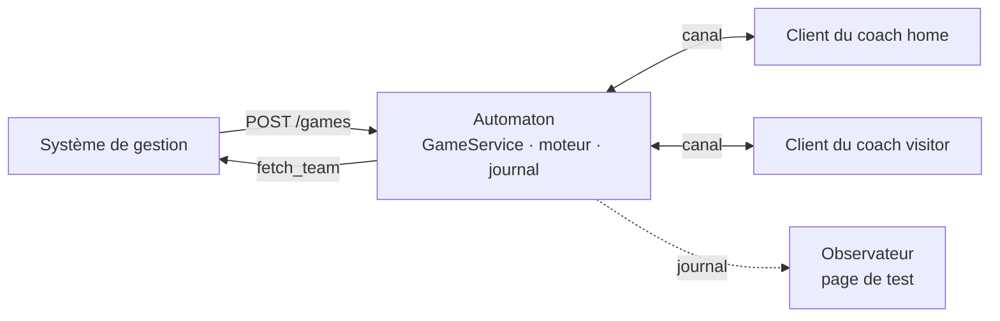

# Protocole du match

Blood Bowl · application `bloodbowl/api` · état du code au 15 novembre 2026

Ce que s'échangent les trois parties d'un match : l'automaton, le système de
gestion et le client d'affichage. Ce document décrit ce qui est en place ; la
dernière section liste ce qui est spécifié mais pas encore réalisé. Version
mise en page : [`protocole.html`](protocole.html).

## Les trois parties

| | L'automaton | Le système de gestion | Le client d'affichage |
|---|---|---|---|
| **Rôle** | Le serveur du match (`make serve`) : moteur, étapes du jeu et application. Seul à tenir le journal, seule source de vérité. | Le service tiers qui crée les matchs et détient les équipes (ligue, rosters, joueurs). | Le client de jeu d'un coach : un par coach, relié par une websocket. Il affiche ce qui descend et monte les commandes du coach. |
| **Prend l'initiative de** | demander les équipes au système de gestion ; pousser les demandes et la fin du match aux coachs. | créer un match. Il répond ensuite aux demandes de fiche d'équipe. | se connecter (c'est ce qui fait rejoindre le match) et envoyer les commandes. |
| **Aujourd'hui** | `bloodbowl/api/service.py` | Aucun vrai système n'est branché : un faux en mémoire (`InMemoryManagementSystem`) invente les fiches, et la page de test joue l'appelant. | La page de test (`/`) joue les deux coachs, plus un observateur en lecture seule. |

## La carte des échanges

Quatre liaisons. Une seule est synchrone de bout en bout : la création du
match, qui ne répond qu'une fois les équipes obtenues.



| Liaison | Transport | Qui ouvre | Attend-on la réponse ? |
|---|---|---|---|
| Création du match | HTTP `POST /games` | le système de gestion | oui : `201` après la récupération des équipes |
| Fiche d'équipe | port `ManagementSystem.fetch_team` | l'automaton | oui, exécutée sur place : la seule demande dans ce cas |
| Canal du coach | websocket `/games/{game_id}/coaches/{coach_id}/ws` | le client | non : tout descend sans attente, la réponse monte plus tard |
| Observation | websocket `/ui/games/{game_id}/ws` | la page de test | non : lecture seule |

## Le lancement, pas à pas

Un match complet tel que le code le joue aujourd'hui : il s'arrête après
l'avant-match, quand l'équipe qui engage est choisie.

| # | Sens | Ce qui se passe |
|---|---|---|
| 1 | Gestion → Auto | `POST /games` avec le coach et l'équipe de chaque camp. |
| 2 | Automaton | Tire l'identifiant du match et la seed des dés (deux ULID), démarre `start_game` : fait `GameStarted`, puis empile `pending_teams`, qui ouvre une requête par camp au système de gestion. |
| 3 | Auto → Gestion | `fetch_team(team_id)` pour home, puis pour visitor. Chaque fiche devient une commande `record_team`, rendue au moteur : fait `TeamFetched`, tous les joueurs dans le Box des Réserves. |
| 4 | Automaton | Les deux fiches reçues, `start_game` empile `pending_coaches` : une demande `join_game` par coach. Elles sont annoncées sur les canaux, mais personne n'est encore connecté : les messages sont perdus, le rattrapage s'en chargera. |
| 5 | Auto → Gestion | Réponse `201 {"game_id": …}`. Le système de gestion transmet l'identifiant du match aux coachs, par un moyen que l'automaton ne définit pas. |
| 6 | Client → Auto | Le client du coach home ouvre son canal. L'automaton vérifie que c'est bien un coach du match, puis envoie lui-même `join_game` pour lui : fait `CoachJoined`, et le client reçoit `accepted`. |
| 7 | Client → Auto | Le coach visitor ouvre son canal à son tour. Les deux coachs sont là : `start_game` empile `pre_match`, qui enchaîne sans interaction le Facteur de Popularité, la météo et le tir au dé. |
| 8 | Auto → Client | Le gagnant du tir au dé reçoit la demande `kick_off_choice`. |
| 9 | Client → Auto | Il répond `choose_kick_off` (`kick` ou `receive`) : fait `KickingTeamChosen`, accusé `accepted`. |
| 10 | Auto → Clients | L'avant-match est fini, la pile se vide : `finished` est poussé aux deux coachs connectés, avec les facteurs de popularité, la météo et le camp qui engage. Cette fin est provisoire. |

> **Les coachs ne voient pas encore le match.** Le client ne reçoit que les
> demandes qui lui sont adressées, les accusés et la fin. Les jets de dés, la
> météo ou le résultat du tir au dé ne lui parviennent pas : seul
> l'observateur de la page de test voit le journal. Le relais des faits est
> l'objet du ticket `relay_facts_to_coaches` (A3).

## Système de gestion ↔ automaton

### Gestion → Auto : créer un match

```
POST /games
{
  "home_coach":    "01J…",   // ULID du coach home
  "home_team":     "01J…",   // ULID de son équipe
  "visitor_coach": "01J…",
  "visitor_team":  "01J…"
}
```

| Réponse | Quand |
|---|---|
| `201 {"game_id": "01J…"}` | le match est créé ; ses équipes ont été demandées (et en principe obtenues) |
| `422` | champ manquant ou en trop, identifiant mal formé, même coach ou même équipe des deux côtés |
| `409 {"detail": …}` | le match existe déjà (l'identifiant étant tiré par l'automaton, cela ne devrait pas arriver) |

Une panne du système de gestion pendant la création ne fait pas échouer
`POST /games` : elle est écrite dans les logs, et la requête reste ouverte
dans le journal.

### Gestion → Auto : lire le journal

`GET /games/{game_id}/journal` rend toutes les entrées du journal en JSON
(`404` si le match est inconnu). C'est aujourd'hui la seule façon, hors
observateur, de connaître le déroulé du match.

### Auto → Gestion : demander la fiche d'une équipe

L'étape `pending_teams` ouvre, pour chaque camp, une requête adressée au
système de gestion :

```json
{"to": "management_system", "action": "fetch_team", "team_id": "01J…"}
```

Le service ne la pousse pas : il l'exécute sur place, par le port
`ManagementSystem`, qui rend une fiche d'équipe.

| Champ de la fiche | Contrainte |
|---|---|
| `roster_id` | un ULID |
| `dedicated_fans` | de 1 à 7 |
| `players` | de 1 à 16 ULID, sans doublon |

La fiche devient la commande `record_team`, rendue au moteur sous la clé et
le numéro de la requête ; l'étape émet `TeamFetched`.

`pending_teams` refuse une fiche d'une équipe qui ne joue pas ce match, ou
déjà reçue ; elle rouvre alors les requêtes des camps encore attendus. Une
même requête n'est exécutée qu'une fois par traitement, pour qu'une
réouverture ne fasse pas tourner la boucle.

> **Pas de relance.** Si le système de gestion est en panne, la requête reste
> ouverte et rien ne la réexécute plus tard. Aucune demande n'est ouverte aux
> coachs pendant `pending_teams` : le match reste bloqué, et seuls les logs en
> donnent la raison.

## Le canal du coach

Une websocket par coach et par match, messages en JSON. C'est le contrat du
client d'affichage (docstring de `bloodbowl/api/channels.py`).

```
ws://<serveur>/games/{game_id}/coaches/{coach_id}/ws
```

### Ouvrir le canal, c'est rejoindre

| Situation | Ce que reçoit le client |
|---|---|
| match inconnu | `{"type": "refused", "status": 404, …}`, puis fermeture `4404` |
| ce coach ne joue pas ce match | `{"type": "refused", "status": 403, …}`, puis fermeture `4403` |
| première connexion | l'automaton envoie `join_game` pour lui : `accepted`, et les demandes que son arrivée a ouvertes |
| reconnexion (il a déjà rejoint) | le rattrapage : chacune de ses demandes encore ouvertes, au format `request` |

> **Pas d'authentification.** Connaître l'identifiant du match et celui d'un
> de ses coachs suffit pour ouvrir son canal et jouer à sa place.

### Auto → Client : ce qui descend

| Message | Quand |
|---|---|
| `{"type": "request", "key": …, "request_id": …, "options": {…}}` | une étape attend une commande de ce coach, et de lui seul. `options.accepts` liste les commandes possibles |
| `{"type": "accepted", "command": {…}}` | la commande que le coach vient d'envoyer a été traitée |
| `{"type": "refused", "status": …, "detail": "…"}` | sa commande a été refusée ou n'a pas pu être lue |
| `{"type": "finished", "output": {…}}` | la pile du match est vide ; envoyé à tous les coachs connectés |

Exemple, la demande faite au gagnant du tir au dé :

```json
{"type": "request", "key": "kick_off_choice", "request_id": 7,
 "options": {"to": "coach", "coach_id": "01J…", "accepts": ["choose_kick_off"]}}
```

### Client → Auto : ce qui monte

Une commande par message, dans une enveloppe : `{"command": {"type": …, …}}`.
Le client ne désigne pas la demande à laquelle il répond : l'automaton sert
l'unique demande ouverte à ce coach.

| Commande | Champs | Répond à |
|---|---|---|
| `join_game` | `coach_id` | la demande d'arrivée ; envoyée par l'automaton lui-même à la connexion, le client n'a pas à l'envoyer |
| `choose_kick_off` | `choice` : `"kick"` ou `"receive"` | `kick_off_choice`, au gagnant du tir au dé |

| Refus `status` | Cause |
|---|---|
| `422` | message illisible : JSON invalide, enveloppe ou commande mal formée |
| `409` | aucune demande ouverte pour ce coach, plusieurs à la fois, ou commande refusée par l'étape (mauvaise commande, coach inattendu…) |
| `404` | match inconnu |
| `500` | erreur inattendue, écrite dans les logs |

### Ce que le client doit savoir

- Une même demande peut arriver deux fois (annonce, puis rattrapage) : il la
  reconnaît à sa clé et son `request_id`.
- Ne pas compter sur l'ordre entre l'accusé d'une commande et les demandes
  que cette commande vient d'ouvrir.
- Rien n'est gardé pour un client déconnecté : à la reconnexion, il reçoit
  ses demandes encore ouvertes, mais ni les accusés ni la fin du match
  manqués.
- Une commande refusée par l'étape a consommé sa demande : l'étape rouvre ce
  qu'elle attend encore, et la nouvelle demande descend avec un nouveau
  `request_id`.

### L'observateur de la page de test

`/ui/games/{game_id}/ws` pousse le journal du match sous forme de fragments
HTML (extension ws de HTMX), à la connexion puis à chaque changement. C'est
un outil de test, pas un contrat pour le client d'affichage.

## Les demandes ouvertes par les étapes

Le destinataire est écrit dans `options.to` : une convention entre les étapes
et l'application, que le moteur ne lit pas.

| Étape | Clé | Destinataire | Accepte | Quand |
|---|---|---|---|---|
| `pending_teams` | `home`, `visitor` | système de gestion | `record_team` | à la création |
| `pending_coaches` | `home`, `visitor` | le coach du camp | `join_game` | tant qu'un coach manque |
| `decide_kicking_team` | `kick_off_choice` | le gagnant du tir au dé | `choose_kick_off` | après le tir au dé |

## Les faits du match

Ce que le journal retient du match. Ils sont lisibles par
`GET /games/{id}/journal` et l'observateur, mais pas encore relayés aux
coachs.

| Fait | Champs | Émis par |
|---|---|---|
| `game_started` | game_id, expected_home_coach, expected_visitor_coach, home_team, visitor_team, dice_seed | `start_game` |
| `team_fetched` | side, team_id, roster_id, dedicated_fans, players | `pending_teams` |
| `coach_joined` | side, coach_id | `pending_coaches` |
| `dice_rolled` | rolls (faces, value) | toute étape qui jette des dés |
| `fan_factor_determined` | side, dedicated_fans, casual_fans, fan_factor | `determine_fans` |
| `weather_determined` | roll, weather | `determine_weather` |
| `roll_off_won` | side | `decide_kicking_team` |
| `kicking_team_chosen` | side | `decide_kicking_team` |

## Les règles qui tiennent l'ensemble

- **Le journal d'abord, l'annonce ensuite.** Un verrou par match sérialise
  les écritures ; les demandes ne sont annoncées qu'une fois le verrou rendu.
- **Une commande n'entre au journal que si sa demande est ouverte.** Le
  `request_id` écarte les réponses en retard.
- **L'auteur est le canal.** Le coach est celui du chemin de la websocket ;
  il ne peut répondre ni au système de gestion, ni à la place de l'autre
  coach.
- **Une panne d'adapter ne fait rien échouer.** Annonce perdue ou système de
  gestion en panne : c'est écrit dans les logs, et la commande déjà
  enregistrée reste valable.
- **Le match est rejouable.** Seed des dés tirée à la création, curseur dans
  le contexte : rejouer le journal redonne les mêmes jets, sans réexécuter
  les étapes.

## À venir

Spécifié dans le kanban (`bloodbowl/specs/`), pas encore dans le code.

### A3 · Placement des équipes (5-tickets)

- Nouveau message descendant `{"type": "fact", "seq": …, "fact": {…}}` :
  chaque fait relayé aux deux coachs, numéroté par son rang dans le journal ;
  le client range par `seq` et ignore les doublons (`relay_facts_to_coaches`).
- Nouvelles commandes montantes `place_player`, `reserve_player`,
  `end_set_up`, et la demande `set_up` rouverte avec ses motifs de refus
  (`set_up_team`).
- Ouvert : ce que reçoit un coach qui se reconnecte, et si tous les faits
  sont relayés.

### A28 · Équipes réelles du système de gestion (5-tickets, questions en cours)

- La fiche devient l'export complet au format Kreek (équipe, coach, roster,
  relances, apothicaire, joueurs avec caractéristiques et compétences) ; le
  roster est identifié par son code (`HUMAN`…).
- Le faux lit les fiches de `bloodbowl/data/teams/`, par `team.id`.
  L'adapter HTTP réel est reporté (recommandation :
  `GET <base>/teams/<team_id>`).
- Une fiche mal formée, ou d'une équipe inconnue, est une panne du système
  de gestion ; une fiche dont le coach n'est pas celui attendu est refusée
  par `pending_teams`.
- Une requête au système de gestion ne répond qu'une fois par clé et par
  traitement (`management_requests_once_per_key`).

### A29 · Rejoindre un match par code, A30 · Match d'exhibition (1-backlog)

Pas encore définies. A29 répondrait à la question laissée ouverte à l'étape 5
du lancement : comment le client apprend le match qu'il doit rejoindre.
